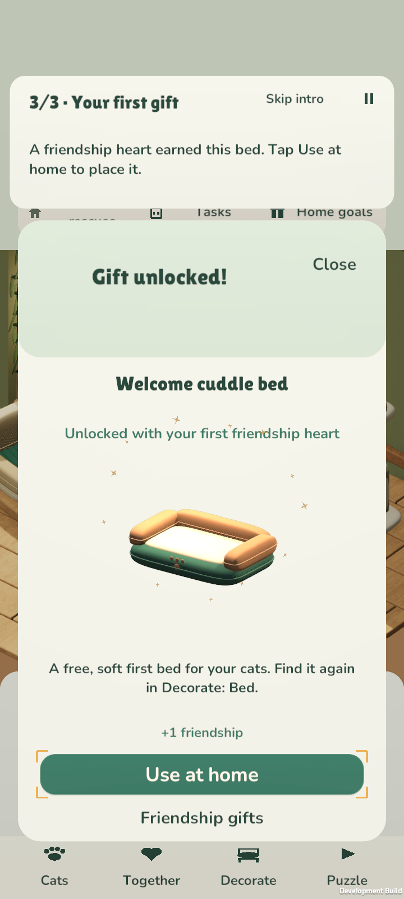
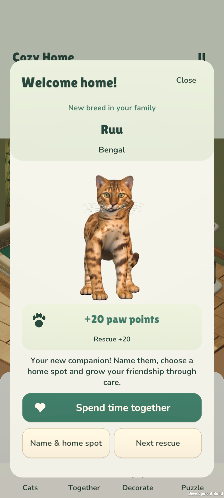

# Cat Rescue: Cozy Home

Little puzzles. Happy cats.

**[Download the latest Android version](https://github.com/MyTribe-Tomi/cat-rescue-cozy-home/releases/latest/download/CatRescue.apk)**

Save this link on your phone. It always points to the latest uploaded update and works without the developer’s computer being on. No GitHub account is needed to download.

Slide furniture to open a safe path, rescue cats, and give them a cozy home. Discover 90 puzzles, eight distinct cat breeds, two home areas, daily and weekly goals, gentle music and natural cat sounds.

## Install or update

1. Open the download link on your Android phone.
2. Open **CatRescue.apk** and allow installation from your browser if Android asks.
3. Choose **Update** if Tassukoti or Cat Rescue is already installed. Keep the existing app installed to keep your progress.

Android 8 or newer, 64-bit ARM, OpenGL ES 3. This is an Android test version, not a Google Play release. Your game saves locally on your phone and works offline. New players start in English; existing language choices remain. Finnish, Swedish, French, Italian, German and Spanish are also available in Settings.

## Asennus suomeksi

Avaa yllä oleva latauslinkki puhelimella. Avaa ladattu **CatRescue.apk** ja valitse **Päivitä**. Älä poista aiempaa Tassukoti-sovellusta: päivitys säilyttää etenemisen ja ääniasetukset. Sovellus näkyy päivityksen jälkeen nimellä **CatRescue**, uudella kissakuvakkeella. Macin ei tarvitse olla päällä eikä puhelimen tarvitse olla samassa Wi-Fi-verkossa.

## Updates

[Latest version and release notes](https://github.com/MyTribe-Tomi/cat-rescue-cozy-home/releases/latest)

## Test ads and ad-free purchases — 0.4.10

Open **Settings → Ad-free home**. **Preview test ad** shows a local preview. Choose **Test purchase · €4.99 → Confirm test purchase** to try permanent ad removal. No money is charged: this is the game's local test shop, not Google Play or the App Store.

Try restoration with **Test options → Forget access · try restore → Restore purchases**. Your test purchase returns without buying again. It also survives closing and reopening the game. You can simulate cancellation, a pending payment, a declined payment and unavailable ads. **Reset test purchase** lets you start the purchase test again.

Rare automatic local test breaks can appear after a completed rescue: never on the first visit, during the introduction or care, and only after at least five rescues, three completed puzzles and five active minutes. Caps: two breaks per visit, four per UTC day. Ad-free ownership removes them; pending purchases keep ads paused.

Optional bonus previews award **test points only**, up to two bonuses per UTC day. Ad-free players claim the same test bonus without an ad. Test points do not change your game balance. Your rescued cats, furniture, rewards and progress stay safe.

Suomeksi: **Asetukset → Mainokseton koti**. Kokeile testimainosta, maksutonta testiostoa ja ostoksen palautusta. Testivalikon käyttöoikeuden unohtaminen ei poista kissoja tai etenemistä. Tämä on paikallinen kokeilu: oikeita kauppoja, mainosverkkoa tai veloituksia ei ole kytketty.

## Your first rescue

The introduction guides new players through their first rescue, caring for Milo and placing an earned bed at home. Slide the highlighted crate, rescue Milo, then **Pet** him. The first friendship heart unlocks the free **Welcome cuddle bed**. Choose **Use at home** to see it in your room, then continue to the next puzzle.

You can skip the introduction or resume it after closing the game. Updating keeps your existing progress and does not force the introduction on returning players. Find the app on your phone as **CatRescue**, with its new kitten icon.

## Try the tutorial again

Open **Settings → Try tutorial**. Practice rescuing Milo, caring for him, and placing the free bed. **Exit practice** or **Back to my game** returns to your own game. Your cats, names, furniture, points and unfinished puzzles stay safe. Practice rewards stay in the practice. Closing the app during practice also returns to your own saved game when you reopen it.

Suomeksi: **Asetukset → Kokeile opastusta**. **Poistu opastuksesta** palauttaa omaan peliin. Harjoituksen palkinnot jäävät harjoitukseen; oma eteneminen säilyy.

## Friendship makes a home

Caring has its own close-up view, an animated friendship meter and six permanent gifts for your home. Every rescued cat contributes to the same heart total.

| Shared hearts | Your gift |
| --- | --- |
| 1 | Welcome cuddle bed — your first free gift |
| 6 | Treat time — a new way to care for your cats |
| 12 | Woven window bed |
| 24 | Feather play — a new playful interaction |
| 36 | Blossom dining set |
| 60 | Canopy cat tree |

Open **Together** at home. Pet, play or brush, then follow the next gift shown below the activities. Each activity gives one heart per cat each day or after a new rescue, up to 12 hearts per cat. **Next cat** helps you visit another friend. You can keep caring for fun after an activity has earned its heart.

Open **Help** at home for the three-step guide: rescue cats, build friendship, and furnish their home. Each card takes you to that part of the game.

You can inspect every **Friendship gift**, including locked gifts. Each card explains the heart requirement, what the gift does, and where to find it later. Newly earned gifts show exactly why they unlocked. Choose **Try together** for an activity or **Use at home** for furniture; placing furniture gives a confirmation.

Hearts are never spent. Earned decorations are free and work in both homes. Furniture can also be changed on the second page of its **Decorate** category. Other furniture costs paw points; **Home goals** list their own requirements. Your previous friendship and chosen furniture are preserved when updating.

Rescuing still welcomes each cat with an animated portrait and a clear reward count. Choose a name and home spot, then spend time together. Your cats live in your home; they do not change puzzle rules. Repeat rescues never give duplicate rewards.

Actual Android screenshots from the running game. The introduction, first gift and home pictures use a fresh, separate test save played through its first rescue and care. The collection previews use 65 rescues, and later decoration previews use 44. Installing an update preserves your own progress.

  

 
