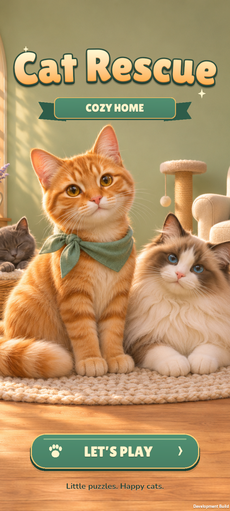
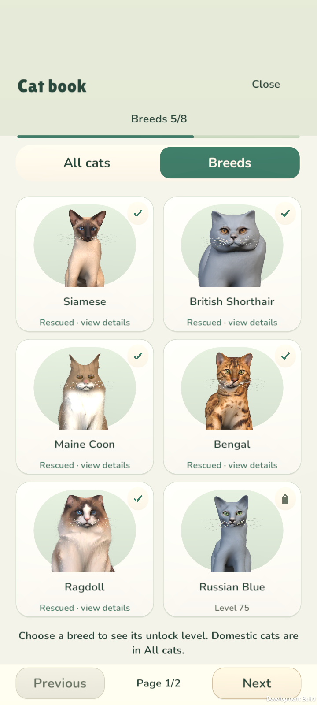
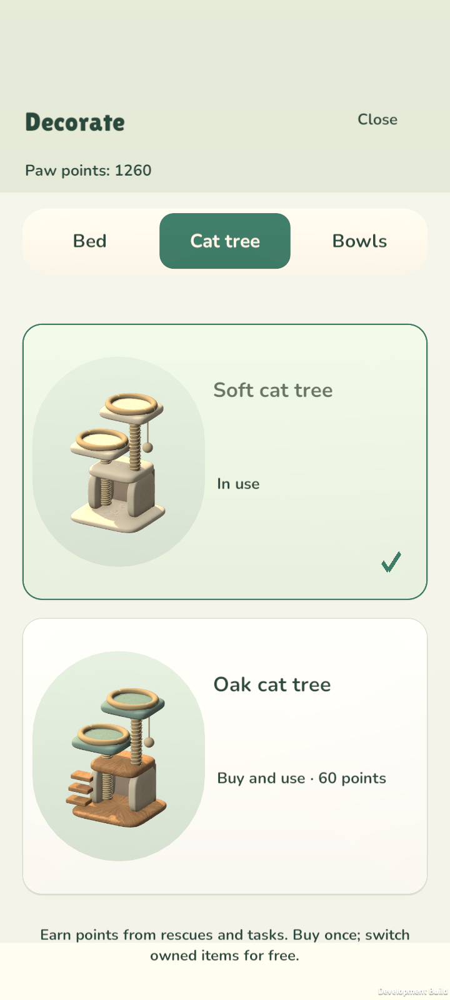
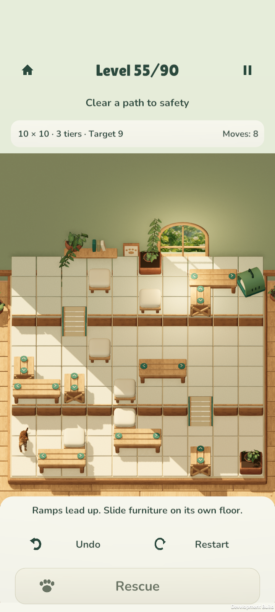
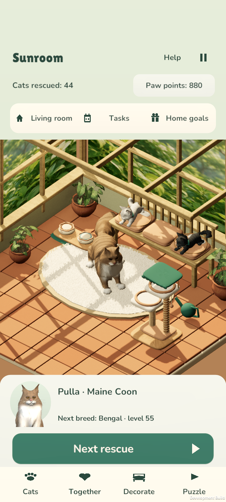

# Cat Rescue: Cozy Home

Little puzzles. Happy cats.

**[Download the latest Android version](https://github.com/MyTribe-Tomi/cat-rescue-cozy-home/releases/latest/download/CatRescue.apk)**

Save this link on your phone. It always points to the latest uploaded update and works without the developer’s computer being on. No GitHub account is needed to download.

Slide furniture to open a safe path, rescue cats, and give them a cozy home. Discover 90 puzzles, eight distinct cat breeds, two home areas, daily and weekly goals, gentle music and natural cat sounds.

## Install or update

1. Open the download link on your Android phone.
2. Open **CatRescue.apk** and allow installation from your browser if Android asks.
3. Choose **Update** if Tassukoti or Cat Rescue is already installed. Keep the existing app installed to keep your progress.

Android 8 or newer, 64-bit ARM, OpenGL ES 3. This is an Android test version, not a Google Play release. Your game saves locally on your phone and works offline. New players start in English; existing language choices remain. Finnish, Swedish, French, Italian, German and Spanish are also available in Settings.

## Asennus suomeksi

Avaa yllä oleva latauslinkki puhelimella. Avaa ladattu **CatRescue.apk** ja valitse **Päivitä**. Älä poista aiempaa Tassukoti-sovellusta: päivitys säilyttää etenemisen ja ääniasetukset. Sovellus näkyy päivityksen jälkeen nimellä **Cat Rescue: Cozy Home**. Macin ei tarvitse olla päällä eikä puhelimen tarvitse olla samassa Wi-Fi-verkossa.

## Updates

[Latest version and release notes](https://github.com/MyTribe-Tomi/cat-rescue-cozy-home/releases/latest)

## Meet your cats, make their home yours

Version 0.4.3 adds an illustrated cat collection, larger animated cat details and decoration cards showing the real 3D furniture. Clear rescue levels, selected tabs and equipped-item markers explain what is available. Care, daily and weekly tasks, and home goals now share the same gentle cream-and-sage style.

Actual Android screenshots from the running game. Collection and home previews use a separate test save with 65 rescues; installing an update preserves your own progress.

  

 
